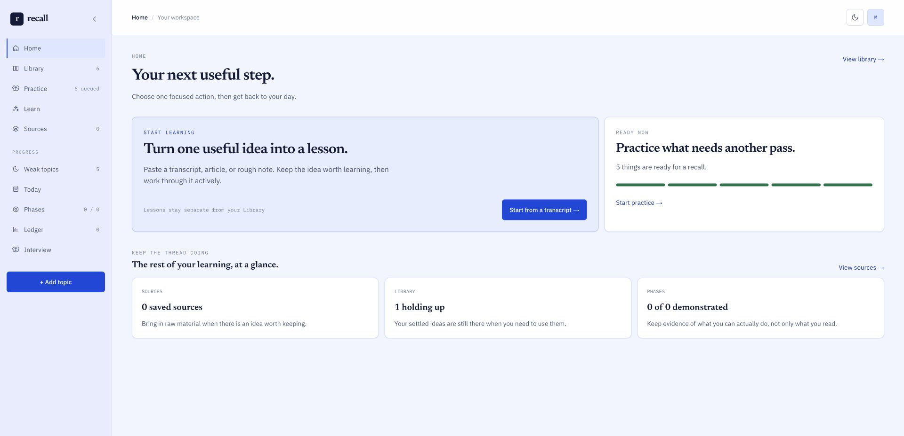
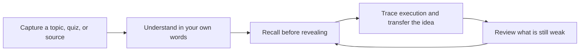
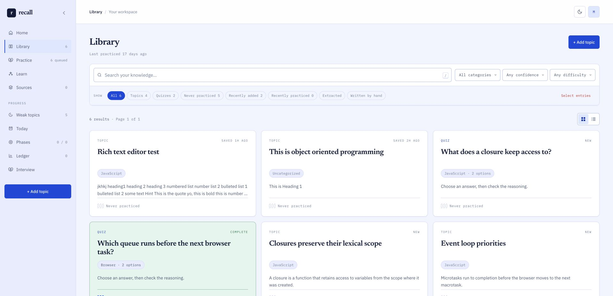
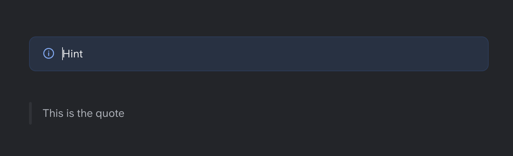
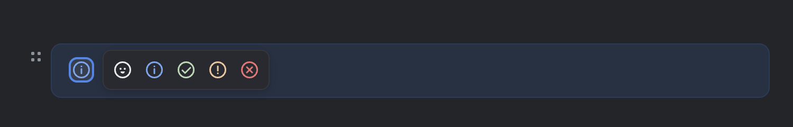

# Recall

> A personal learning workspace for turning things you understand today into things you can still explain, apply, and build with later.

[](https://nextjs.org/)
[](https://www.typescriptlang.org/)
[](https://supabase.com/)
[](#quality)

Recall is not an LMS, a course platform, or another generic flashcard app. It is a deliberately small system for technical learning: capture a concept in your own words, practise retrieving it, trace how it works, apply it to a new case, and revisit what is still weak.

Built independently as a product-engineering project, from information architecture and interaction design through database constraints, performance work, accessibility, testing, and release.

<p align="center">
  
</p>

## The learning loop



The product separates **topics** from **quizzes** all the way through practice. You can work through everything, focus on weak material, or narrow a session by category—without mixing two fundamentally different learning interactions.

## What is in the product

| Area | What it does |
| --- | --- |
| **Library** | Searchable topic and quiz library with categories, tags, confidence, list/tile views, bulk selection, deletion, pagination, and strong-state visual feedback. |
| **Practice** | Separate topic and quiz practice flows, weak-only filtering, category selection, per-question progress, correct/incorrect feedback, and a useful session summary. |
| **Learn** | Turns a transcript into an active lesson: understand once, recall, trace code, transfer the idea, then add compact prompts to the review queue. |
| **Sources & phases** | Keep the origin of a concept, connect it to a learning phase, and see progress without flattening everything into a single score. |
| **Rich technical notes** | Markdown-compatible rich text with headings, lists, links, bold, italics, quotes, syntax-highlighted code, and configurable hint callouts. |
| **Portable library** | Export a self-contained archive, then add its topics and quizzes to another Recall library without overwriting existing work. |
| **Interview workspace** | A dedicated area to practise and record demonstrated capability, rather than treating learning as a passive reading log. |

The library is designed as a working knowledge base—not a pile of cards. Filters, confidence, category tags, completion state, bulk actions, and tile/list views help someone decide what to learn or revisit next.

<p align="center">
  
</p>

## Rich notes that stay readable

Technical notes need more than a textarea. Recall's editor uses slash commands for structure, keeps content in a safe portable Markdown subset, and renders the same meaningful hierarchy in the editor, library, detail pages, and practice sessions.

<p align="center">
  
</p>

Hints are semantic callouts rather than styled text. Their icon can communicate the intent of the note—information, encouragement, confirmation, warning, or correction—and that choice persists when the note is saved.

<p align="center">
  
</p>

## Architecture: boundaries over cleverness

Recall keeps product decisions testable by giving every layer a narrow job.

```text
src/lib/domain/      Pure business rules. No database imports.
src/lib/data/        The only data-access boundary; maps database rows to domain shapes.
src/lib/supabase/    Browser, server, and session integration via @supabase/ssr.
src/components/ui/   Reusable accessible primitives and interaction models.
src/components/*/    Feature UI: library, practice, learn, sources, phases, interview.
src/app/             Next.js App Router routes and server actions.
supabase/            Migrations, RLS policy tests, and local stack configuration.
e2e/                 Playwright journeys against seeded users.
```

### Decisions that are intentional

- **Domain rules are pure functions.** Search, category suggestions, confidence mapping, practice selection, and rich-text normalisation can run in milliseconds without a database. If a rule needs a database merely to test it, it lives in the wrong layer.
- **Supabase is the backend, not a shortcut around backend design.** Postgres, Auth, Storage, RLS, SQL functions, and migrations are treated as first-class application code.
- **The UI never owns critical data decisions.** Data access is isolated, server actions validate at the boundary, and database constraints backstop the shape of topics and quizzes.
- **Rich content is stored as a safe Markdown subset, not arbitrary HTML.** It stays searchable, exportable, and compatible with plain text surfaces while preserving meaningful formatting.
- **Performance is designed in.** List pages use summary-shaped data and pagination; navigation has loading states; heavy editor/code dependencies are lazy-loaded; bundle budgets and production Web Vitals reporting keep regressions visible.

For the deeper engineering notes—including why each database constraint is tested by proving it rejects bad input—see [ARCHITECTURE.md](ARCHITECTURE.md).

## Stack

| Layer | Technology |
| --- | --- |
| Application | Next.js 16 App Router, React 19, TypeScript (strict) |
| UI | Tailwind CSS v4, accessible custom primitives, CodeMirror, Tiptap / ProseMirror |
| Backend | Supabase: Postgres, Auth, Storage, Row Level Security |
| Quality | Vitest, Testing Library, pgTAP, Playwright |
| Delivery confidence | Typecheck, database migration tests, browser journeys, bundle budgets, Web Vitals reporting |

## Quality

Recall is built around behavioural confidence, not screenshots that happen to look right.

- **717 automated tests** across domain logic and component interaction models.
- **pgTAP database tests** cover schema shape, RLS isolation, storage policy, database functions, and invalid topic/quiz states.
- **Playwright journeys** start from seeded accounts for empty, weak, strong, small, and large-library states.
- **Adversarial constraint tests** remove individual protection clauses to prove each guard is necessary—not only that a valid row can be inserted.
- **Production safeguards** include lazy-loaded editor/code modules, bundle-size checks, loading UI, and Web Vitals reporting.

```bash
npm run verify
```

`verify` runs the typecheck, unit/component tests, parity checks, database tests, end-to-end tests, and bundle budget check.

## Run locally

### Prerequisites

- Node.js 22.18+
- Docker Desktop
- Supabase CLI 2.116+

### Setup

```bash
npm install
supabase start
cp .env.example .env.local
```

Copy the local values printed by `supabase status` into `.env.local`:

| Variable | Local source |
| --- | --- |
| `NEXT_PUBLIC_SUPABASE_URL` | `API_URL` |
| `NEXT_PUBLIC_SUPABASE_PUBLISHABLE_KEY` | `PUBLISHABLE_KEY` |
| `SUPABASE_SECRET_KEY` | `SECRET_KEY` — server only |
| `E2E_*_USER_EMAIL` / `_PASSWORD` | Any values; the seed script creates the accounts |

```bash
npm run dev
```

Open [http://localhost:3000](http://localhost:3000). Local sign-up confirmation and reset emails arrive in Mailpit at [http://127.0.0.1:54324](http://127.0.0.1:54324).

## Project map

| Document | Why read it |
| --- | --- |
| [ARCHITECTURE.md](ARCHITECTURE.md) | Data boundaries, database invariants, performance decisions, and engineering postmortems. |
| [DESIGN.md](DESIGN.md) | Design tokens, component contracts, content style, and interaction rules. |
| [TASKS.md](TASKS.md) | The build record: phases, trade-offs, and deliberate non-goals. |
| [`.env.example`](.env.example) | Safe local environment template. |

## Scope

Recall is intentionally opinionated: one person's private learning workspace, email/password auth, and a focused learning loop. It avoids gamified streaks, social feeds, generic analytics dashboards, and artificial “AI” features that make the core action—learning something well—harder.

---

Built by [Sagar Sinha](https://github.com/sinhasagar01) as an independent frontend and AI product-engineering project.
